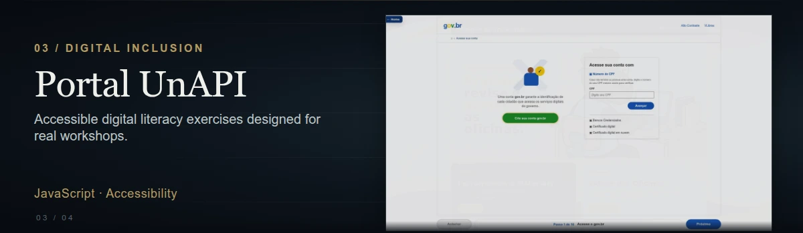
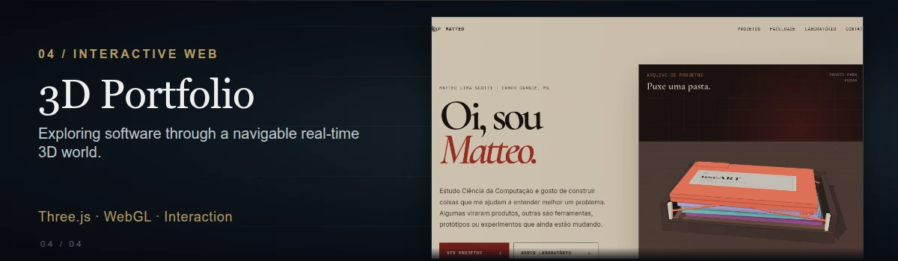

<!-- A continuous, clickable visual story. No Markdown blocks are inserted between frames. -->

<picture><source media="(max-width: 600px) and (prefers-reduced-motion: reduce)" srcset="./assets/hero-perfil-mobile-static.webp" /><source media="(max-width: 600px)" srcset="./assets/hero-perfil-mobile.webp" /><source media="(prefers-reduced-motion: reduce)" srcset="./assets/hero-perfil-estatico.png" /></picture><picture><source media="(max-width: 600px) and (prefers-reduced-motion: reduce)" srcset="./assets/profile-depth-mobile-static.webp" /><source media="(max-width: 600px)" srcset="./assets/profile-depth-mobile.webp" /><source media="(prefers-reduced-motion: reduce)" srcset="./assets/profile-depth-static.webp" /></picture><a href="https://github.com/TeoZ08/jarvis-academico"><picture><source media="(max-width: 600px)" srcset="./assets/project-jarvis-mobile.webp" /><source media="(prefers-reduced-motion: reduce)" srcset="./assets/project-jarvis-panel.webp" /></picture></a><a href="https://github.com/TeoZ08/aquaia-ufms"><picture><source media="(max-width: 600px)" srcset="./assets/project-aquaia-mobile.webp" /><source media="(prefers-reduced-motion: reduce)" srcset="./assets/project-aquaia-panel.webp" /></picture></a><a href="https://github.com/TeoZ08/homeUnapi"><picture><source media="(max-width: 600px)" srcset="./assets/project-unapi-mobile.webp" /></picture></a><a href="https://github.com/TeoZ08/MeuSitePortfolio"><picture><source media="(max-width: 600px)" srcset="./assets/project-portfolio-mobile.webp" /></picture></a>

<a href="https://teoz08.github.io/TeoZ08/#film"><strong>Watch the film</strong></a> · <a href="https://teoz08.github.io/TeoZ08/#projects">Explore interactively</a> · <a href="https://github.com/TeoZ08/TeoZ08/tree/main/motion">Remotion source</a> · <a href="https://github.com/TeoZ08/TeoZ08/blob/main/assets/profile-film.mp4">MP4 file</a>

## About

I'm **Matteo Lima Scotti**, a Computer Science student at **UFMS** and a backend development intern working with **C# / .NET**, APIs, integrations and real-world data flows. I also build applied AI, accessible learning experiences and interactive applications.

I value understanding **why a system works**, not just making it work once.

## Projects at a glance

- **01 · [JARVIS Acadêmico](https://github.com/TeoZ08/jarvis-academico)** — Academic AI with RAG, cited answers and tool calling · [Live](https://teoz08-jarvis-academico.hf.space)
- **02 · [AquaIA UFMS](https://github.com/TeoZ08/aquaia-ufms)** — Water-waste monitoring, campus maps and evidence
- **03 · [Portal UnAPI](https://github.com/TeoZ08/homeUnapi)** — Accessible digital-literacy workshops
- **04 · [3D Portfolio](https://github.com/TeoZ08/MeuSitePortfolio)** — Interactive archive made with Three.js · [Explore](https://teoz08.github.io/MeuSitePortfolio/)

<b>Technologies, current focus & accessibility</b>

**Toolbox:** `C#` · `.NET` · `REST APIs` · `SQL` · `Git` · `Linux` · `Docker` · `Python` · `FastAPI` · `TypeScript` · `React` · `Next.js`

**Current focus:** API design, business rules, system integrations, data persistence, RAG, tool calling, automation and maintainable software.

Prefer not to watch motion? [Open the static panorama](./assets/hero-perfil-estatico.png). All four projects are linked above in plain text as well as through the images. The optional video has playback controls and no autoplay.

build → test → understand → document → improve

