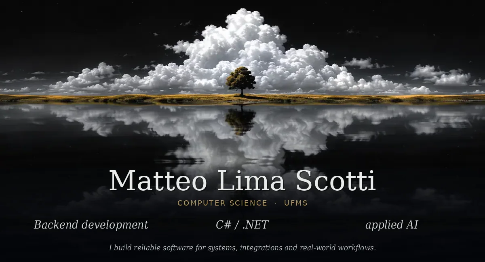

<p align="center">
  
</p>

---

## `$ whoami`

```txt
name      Matteo Lima Scotti
location  Campo Grande, MS — Brazil
degree    Computer Science @ UFMS
role      Backend Development Intern
focus     C# · .NET · REST APIs · integrations · software engineering
```

My current professional focus is **backend development with C# and .NET**. Outside work, I use personal and academic projects to explore web engineering, infrastructure, AI and software that interacts with real-world workflows.

I care about understanding **why a system works**, not just making it work once.

---

## Main toolbox

<div align="center">


</div>

<details>
<summary><b>More technologies I use</b></summary>
<br>

`TypeScript` · `JavaScript` · `React` · `Next.js` · `Python` · `FastAPI` · `Flask` · `PostgreSQL` · `MongoDB` · `Java`

</details>

---

## What I'm working on

```text
backend       C# / .NET · REST APIs · business rules · persistence
integrations  software ↔ services ↔ devices · local/network data flows
ai            RAG · LLM integrations · tool calling · automation
infra         Linux · Docker · deployment · Kubernetes concepts
university    software engineering · networks · distributed systems
```

---

## Selected work

<table>
<tr>
<td width="50%" valign="top">

### JARVIS Acadêmico
Academic copilot combining **RAG, remote LLMs, tool calling, document upload and active review**.

`Python` `FastAPI` `React` `RAG` `Docker`

[Repository →](https://github.com/TeoZ08/jarvis-academico) · [Live system →](https://teoz08-jarvis-academico.hf.space)

</td>
<td width="50%" valign="top">

### AquaIA UFMS
Responsive web app for reporting water waste on campus, with **AI-assisted analysis, prioritization, dashboards and maps**.

`Flask` `SQLite` `Gemini` `Tailwind` `Leaflet`

[Repository →](https://github.com/TeoZ08/aquaia-ufms)

</td>
</tr>

<tr>
<td width="50%" valign="top">

### Portal UnAPI
Digital inclusion portal used to support UFMS workshops, with interactive learning experiences for **gov.br, digital security, mobility, keyboard and mouse**.

`HTML` `CSS` `JavaScript` `Leaflet` `Accessibility`

[Repository →](https://github.com/TeoZ08/homeUnapi)

</td>
<td width="50%" valign="top">

### 3D Portfolio
Full-screen **interactive 3D portfolio** where the visitor explores an outdoor scene, finds a terminal and enters a project hub guided by a controllable robot.

`JavaScript` `Three.js` `WebGL` `3D Interaction`

[Repository →](https://github.com/TeoZ08/MeuSitePortfolio)

</td>
</tr>
</table>

---

## Things I like building

- backend services with explicit business rules;
- integrations between software, APIs and external systems;
- tools that automate repetitive workflows;
- applied AI with visible evidence and practical utility;
- interfaces that make technically complex systems easier to use;
- projects where I can learn the architecture instead of only the framework.

---

## UFMS + real-world practice

I study **Computer Science at UFMS** and try to turn coursework into working software whenever it makes sense. At the same time, my internship gives me contact with backend development in production-oriented systems — especially APIs, integrations, data persistence, maintenance and debugging.

That combination is the part I value most: **theory giving me better questions, and practice forcing better answers.**

---

<div align="center">

### `build → test → understand → document → improve`

<sub>Matteo Lima Scotti · Campo Grande, MS 🇧🇷</sub>

</div>
