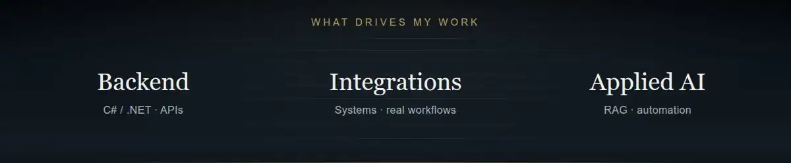
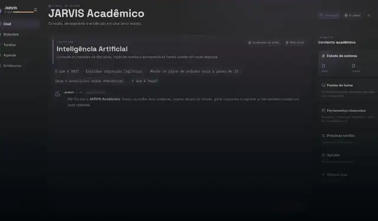
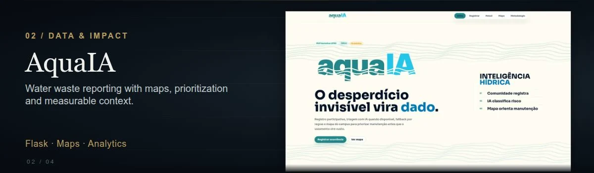
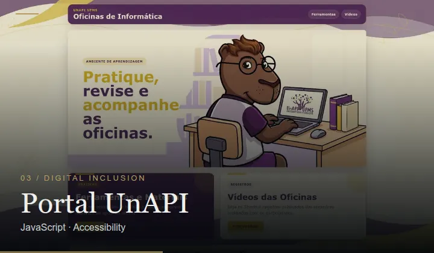
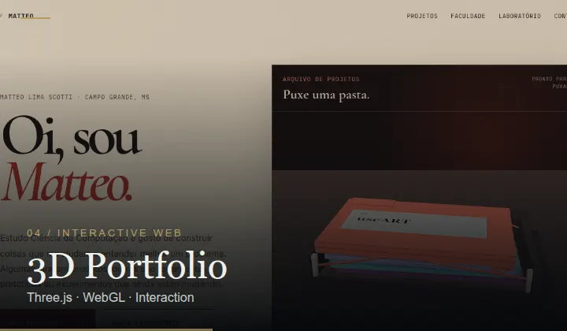
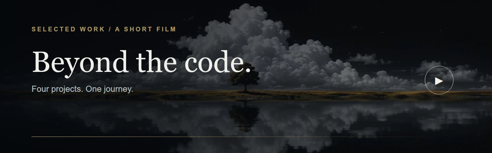
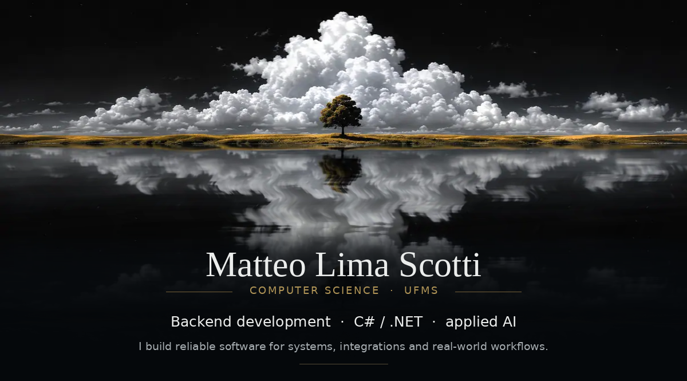

<p align="center">
  
  <picture><source media="(max-width: 600px)" srcset="./assets/profile-depth-mobile.webp" /></picture>
</p>

<p align="center"><sub>Computer Science @ UFMS · Backend Engineering · Integrations · Applied AI</sub></p>

## About

I build software where **backend systems, integrations and applied AI** meet real problems. I'm a Computer Science student at **UFMS** and a backend development intern focused on **C# / .NET, APIs, business rules and data flows**.

Outside work, I explore accessible interfaces, 3D experiences and practical AI tools. My aim is to understand not only whether a system works, but **why**.

<details>
<summary><b>Technical profile and tools</b></summary>

`C#` · `.NET` · `REST APIs` · `SQL` · `Git` · `Linux` · `Docker` · `Python` · `FastAPI` · `TypeScript` · `React` · `Next.js`

```text
backend       C# / .NET · REST APIs · business rules · persistence
integration   software ↔ services ↔ devices · local/network flows
ai            RAG · LLM integration · tool calling · automation
engineering   testing · maintainability · documentation · deployment
```

</details>

---

## Selected work

Every image below opens the **real project repository**. The screenshots are taken from working interfaces, not invented mockups.

<a href="https://github.com/TeoZ08/jarvis-academico"></a>

**JARVIS Acadêmico** — A copilot for academic work combining RAG, document retrieval, LLM integrations, active review and tool calling. **Python · FastAPI · React · Docker.** [Repository](https://github.com/TeoZ08/jarvis-academico) · [Live system](https://teoz08-jarvis-academico.hf.space)

<a href="https://github.com/TeoZ08/aquaia-ufms"></a>

**AquaIA UFMS** — Reporting water waste on campus with map-based evidence, prioritization and useful operational indicators. **Flask · SQLite · Gemini · Leaflet.** [Repository](https://github.com/TeoZ08/aquaia-ufms)

<a href="https://github.com/TeoZ08/homeUnapi"></a>

**Portal UnAPI** — Accessible digital literacy experiences for UFMS workshops: gov.br simulations, digital safety, keyboard and mouse practice. **HTML · CSS · JavaScript · Accessibility.** [Repository](https://github.com/TeoZ08/homeUnapi)

<a href="https://github.com/TeoZ08/MeuSitePortfolio"></a>

**3D Portfolio** — An interactive project archive and exploratory Three.js interface. **JavaScript · Three.js · WebGL.** [Repository](https://github.com/TeoZ08/MeuSitePortfolio) · [Explore live](https://teoz08.github.io/MeuSitePortfolio/)

---

## Beyond the code

A short film rendered with Remotion using real project screens, the original landscape and a custom ambient soundtrack. **31 seconds. Sound optional.**

<a href="https://teoz08.github.io/#film"></a>

<p align="center"><a href="https://teoz08.github.io/#film">Watch the film</a> · <a href="https://github.com/TeoZ08/TeoZ08/blob/main/assets/profile-film.mp4">MP4 file</a> · <a href="https://github.com/TeoZ08/TeoZ08/tree/main/motion">Explore the Remotion source</a></p>

<details>
<summary>Prefer a static, low-motion presentation?</summary>



The project descriptions and links above are available without motion.

</details>

---

## UFMS + real-world practice

I study **Computer Science at UFMS** and turn coursework into working software wherever possible. My internship connects that theory with production-oriented backend engineering — APIs, integrations, persistence, maintenance and debugging.

**Theory brings better questions. Practice demands better answers.**

<p align="center"><sub>build → test → understand → document → improve</sub></p>
